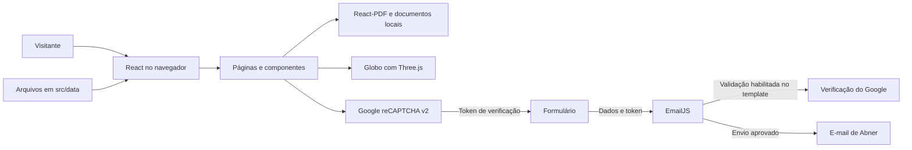
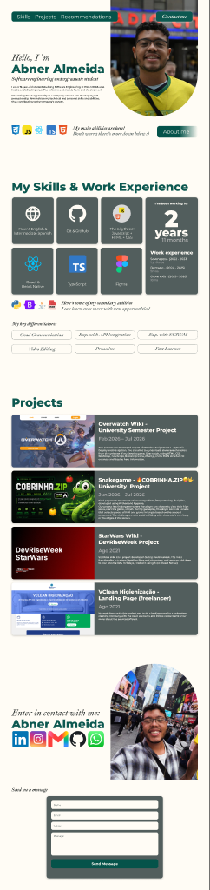
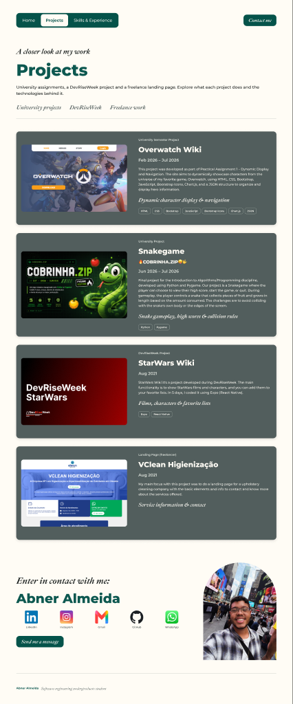
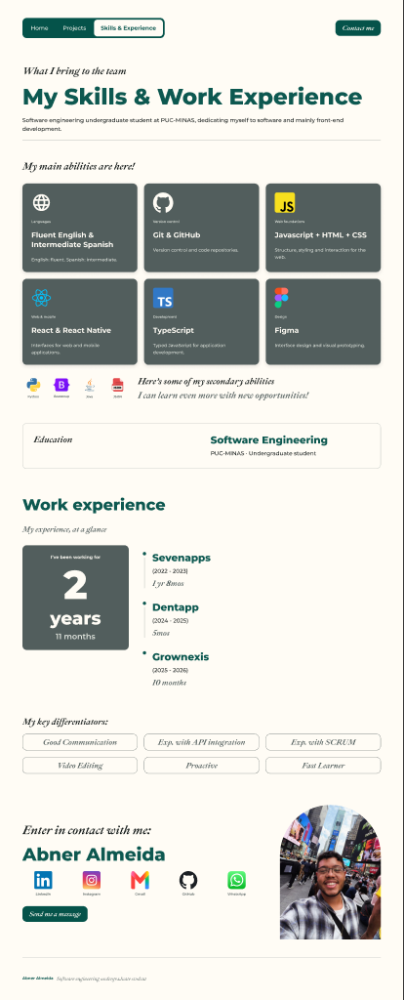
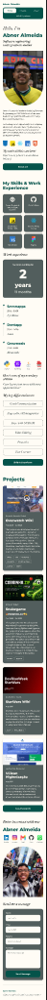
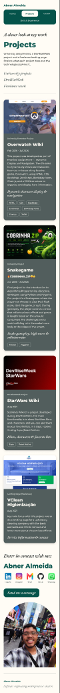
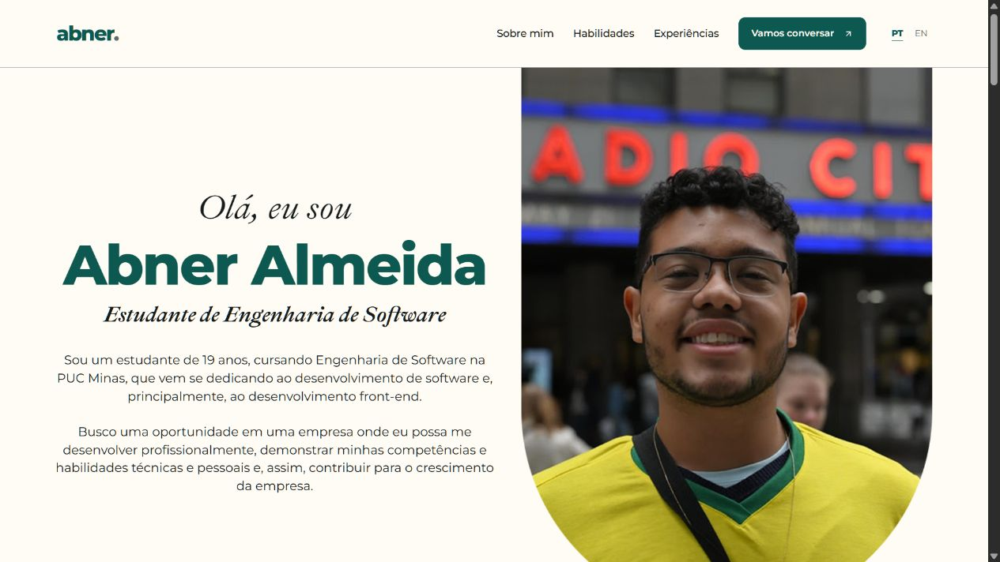
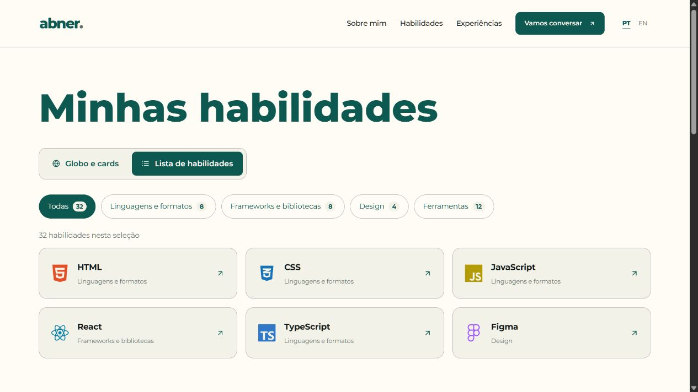
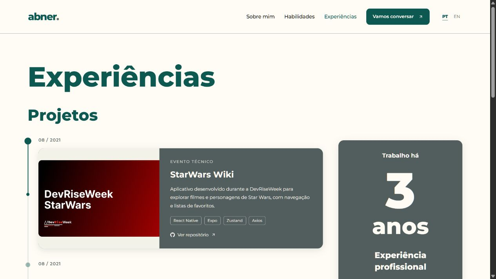
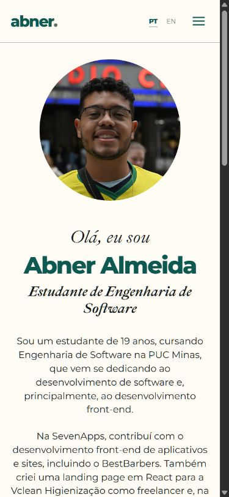

<div align="center">
  
  <h1>Abner Almeida | Portfólio profissional</h1>
  <p>Formação, habilidades e projetos reunidos em uma experiência responsiva, em português e inglês.</p>
</div>

Projeto do **Laboratório 01 (LAB01)** da disciplina **Desenvolvimento e Integração de Aplicações Web (DIAW)**, do 2º período de Engenharia de Software da **PUC Minas**, ministrada pelo **Prof. Dr. João Paulo Carneiro Aramuni**. A documentação adapta o [template oficial da disciplina](https://github.com/joaopauloaramuni/desenvolvimento-e-integracao-de-aplicacoes-web/blob/main/TEMPLATES/template_README.md) ao sistema implementado.

## Status do projeto

**Em desenvolvimento, com aplicação executável localmente.** As páginas, a timeline, os documentos PDF e as integrações de contato estão implementados. A publicação em nuvem ainda não foi realizada pelo autor.

| Item | Situação |
| --- | --- |
| Interface responsiva e conteúdo PT/EN | Implementados |
| Projetos, habilidades e experiências | Implementados; ajustes de conteúdo listados nas [pendências](#pendências-da-entrega) |
| Currículo e carta de recomendação | Disponíveis em visualizador interno de PDF |
| EmailJS e reCAPTCHA v2 | Integrados; recebimento real de e-mail ainda precisa ser confirmado |
| Site publicado na nuvem | **Pendente** |

## Índice

- [Links úteis](#links-úteis)
- [Sobre o projeto](#sobre-o-projeto)
- [Funcionalidades principais](#funcionalidades-principais)
- [Tecnologias utilizadas](#tecnologias-utilizadas)
- [Arquitetura](#arquitetura)
- [Protótipos e decisões de design](#protótipos-e-decisões-de-design)
- [Instalação e execução](#instalação-e-execução)
- [Variáveis de ambiente e envio de e-mail](#variáveis-de-ambiente-e-envio-de-e-mail)
- [Deploy](#deploy)
- [Estrutura de pastas](#estrutura-de-pastas)
- [Demonstração e instruções de uso](#demonstração-e-instruções-de-uso)
- [Testes](#testes)
- [Entregas do laboratório](#entregas-do-laboratório)
- [Documentações utilizadas](#documentações-utilizadas)
- [Autor](#autor)
- [Contribuição](#contribuição)
- [Agradecimentos e créditos](#agradecimentos-e-créditos)
- [Licença](#licença)

## Links úteis

- **Site publicado:** ainda não publicado. O endereço definitivo deverá ser incluído aqui após o deploy da Sprint 03.
- [Repositório do portfólio](https://github.com/abneralmeidacord/abneralmeida-portfolio)
- [Protótipos no Figma](https://www.figma.com/design/mfA3J610RzWl3o9r5k5BaF/Portfolio---website?node-id=0-1)
- [GitHub de Abner Almeida](https://github.com/abneralmeidacord)
- [LinkedIn](https://www.linkedin.com/in/abner-almeida-/)
- [Contato por e-mail](mailto:abnersolk@gmail.com)

## Sobre o projeto

O portfólio apresenta minha trajetória acadêmica e profissional, facilita a consulta aos meus trabalhos e permite o contato de recrutadores, empresas e possíveis parceiros. A proposta é reunir, em um único site, informações que normalmente ficam distribuídas entre currículo, redes profissionais e repositórios.

A aplicação foi construída com React e Vite, com componentes em JavaScript/JSX e estilos em CSS. O conteúdo possui versões em português e inglês e pode ser acessado em computadores e celulares. Além do escopo do laboratório, o site oferece um globo interativo de habilidades e visualização de documentos sem sair da página.

## Funcionalidades principais

| Área | Recursos implementados |
| --- | --- |
| Apresentação | Formação, interesses, objetivos e texto de apresentação em PT/EN |
| Sobre mim | Trajetória, retrato circular no celular e seta para acessar os documentos |
| Documentos | Currículos em português e inglês conforme o idioma selecionado; carta de recomendação; paginação, zoom e download |
| Habilidades | 32 habilidades, incluindo MDX; alternância entre globo com cards e lista; categorias e contagens |
| Globo 3D | Rotação, arrasto, links e pausa; alternativa textual quando WebGL não está disponível |
| Experiências | Instituição, cargo, período e duração; total em anos e meses atualizado a partir dos vínculos cadastrados |
| Projetos | Cinco projetos em ordem cronológica, com nome, descrição, tecnologias, imagem e repositório; links adicionais quando disponíveis |
| Contato | Links para e-mail, WhatsApp, LinkedIn, Instagram e GitHub; formulário com nome, e-mail, assunto opcional e mensagem |
| Envio | Integração com EmailJS, validação dos campos, estados de envio/sucesso/erro e reCAPTCHA v2 horizontal |
| Navegação e acessibilidade | Menu mobile, seletor PT/EN, link para pular ao conteúdo e respeito à preferência de movimento reduzido |
| Animações | Loading por página, digitação na apresentação, entrada de textos e cards, diferenciais de baixo para cima e timeline progressiva |
| Temas | Modo claro/escuro pelo botão de sol/lua no cabeçalho; preferência salva no navegador e tema do sistema no primeiro acesso |

## Tecnologias utilizadas

### Linguagens, ferramentas e serviços

- **JavaScript/JSX e HTML:** lógica e estrutura dos componentes.
- **CSS:** layouts com Grid/Flexbox, responsividade e tokens de cores e fontes.
- **React:** composição da interface, estado e ciclo de vida dos componentes.
- **Vite e npm:** desenvolvimento, instalação de dependências e build.
- **Figma:** planejamento das telas e identidade visual.
- **Git e GitHub:** versionamento e repositório.
- **EmailJS e Google reCAPTCHA v2:** processamento externo do formulário e verificação antispam.
- **Google Fonts:** fontes Montserrat e Ibarra Real Nova, com alternativas de sistema.

As tecnologias listadas nos cards dos projetos e nas habilidades representam também outros trabalhos e conhecimentos do autor. Por exemplo, Next.js, Expo e MDX aparecem no conteúdo do portfólio, mas não são dependências desta aplicação.

### Bibliotecas e dependências

Versões resolvidas no `package-lock.json`. Para reproduzir a instalação, utilize `npm ci`.

| Dependência | Versão | Finalidade |
| --- | --- | --- |
| `react` / `react-dom` | 19.3.0 | Componentes e renderização |
| `motion` | 14.3.0 | Animações, loading, digitação e timeline |
| `react-icons` | 5.7.0 | Ícones da interface e das habilidades |
| `react-pdf` | 10.3.0 | Visualizador interno de PDF |
| `three` | 0.186.1 | Renderização do globo 3D |
| `@react-three/fiber` | 9.8.1 | Integração do Three.js com React |
| `@react-three/drei` | 10.7.9 | Recursos auxiliares do globo |
| `@emailjs/browser` | 5.0.3 | Envio das mensagens pelo EmailJS |

O `pdfjs-dist` 5.4.296 é uma dependência transitiva usada pelo visualizador. O reCAPTCHA utiliza o script oficial do Google, sem pacote npm adicional.

| Dependência de desenvolvimento | Versão | Finalidade |
| --- | --- | --- |
| `vite` | 8.3.4 | Servidor local e build |
| `@vitejs/plugin-react` | 6.1.2 | Integração entre Vite e React |
| `eslint` | 10.12.0 | Análise estática do código |
| `@eslint/js` | 10.0.1 | Regras JavaScript do ESLint |
| `eslint-plugin-react-hooks` | 7.1.1 | Regras dos hooks React |
| `eslint-plugin-react-refresh` | 0.5.7 | Verificações para atualização durante o desenvolvimento |
| `globals` | 17.13.0 | Definição dos ambientes do ESLint |

## Arquitetura

A aplicação é uma **SPA (Single Page Application)** executada no navegador. As páginas ficam em `src/pages`, os componentes reutilizáveis em `src/components` e o conteúdo em `src/data`. Essa separação permite atualizar projetos, habilidades e traduções sem reescrever o layout.



O processamento de e-mail é delegado ao EmailJS. O projeto não possui API própria nem banco de dados: os dados apresentados são arquivos locais, e as mensagens são processadas pelo serviço externo. A verificação do token do reCAPTCHA deve estar habilitada no template do EmailJS.

A navegação usa `usePageNavigation` e rotas com `#`, permitindo abrir os endereços diretamente e usar Voltar/Avançar em hospedagens estáticas. O globo e o visualizador de PDF são carregados sob demanda. O Vite copia os recursos auxiliares do PDF.js para `public/pdfjs/` ao iniciar ou gerar o build.

O contador profissional utiliza os dados de `experiences.js`: vínculos com datas são combinados sem duplicar meses simultâneos; vínculos antigos com datas incompletas usam a duração informada pelo autor. As animações respeitam movimento reduzido e evitam atualizar o estado React a cada frame da rolagem.

## Protótipos e decisões de design

O [arquivo do Figma](https://www.figma.com/design/mfA3J610RzWl3o9r5k5BaF/Portfolio---website?node-id=0-1) reúne o planejamento desktop e mobile. As miniaturas abaixo foram exportadas dos seis frames desse arquivo; o Figma permite consultar os detalhes em resolução completa.

<details>
<summary>Ver os seis protótipos</summary>

| Página principal | Projetos desktop | Habilidades e experiências desktop |
| --- | --- | --- |
| [](docs/prototypes/main.png) | [](docs/prototypes/projects-desktop.png) | [](docs/prototypes/skills-desktop.png) |

| Página principal mobile | Projetos mobile | Habilidades e experiências mobile |
| --- | --- | --- |
| [](docs/prototypes/home-mobile.png) | [](docs/prototypes/projects-mobile.png) | [](docs/prototypes/skills-mobile.png) |

</details>

A identidade combina fundo claro, verde escuro, títulos de destaque e uma fonte serifada nos textos de apresentação. O layout usa cards para facilitar a leitura e mantém as imagens dos projetos em sua proporção original.

Durante o desenvolvimento, o menu passou a reunir Sobre mim, Habilidades, Experiências e Contato. Os projetos foram incorporados à página Experiências, ao lado do resumo profissional, e continuam acessíveis pela página inicial. O formulário fica ao lado da foto de contato no desktop; no celular, os blocos se empilham. As capturas da implementação estão na seção [Demonstração](#demonstração-e-instruções-de-uso).

## Instalação e execução

### Pré-requisitos

- **Node.js 22.12 ou superior**, em uma versão compatível com o Vite instalado. Ambiente de desenvolvimento conferido com Node.js 22.14.0 e npm 11.3.0.
- **npm** e **Git**.
- Navegador atualizado; WebGL é necessário para o globo 3D. Sem WebGL, há uma alternativa textual.
- Conexão com a internet para Google Fonts, reCAPTCHA e EmailJS.

### Instalação e desenvolvimento

```bash
git clone https://github.com/abneralmeidacord/abneralmeida-portfolio.git
cd abneralmeida-portfolio
npm ci
npm run dev
```

Abra o endereço exibido no terminal, normalmente `http://localhost:5173`. Se a porta estiver ocupada, o Vite informa outra. Para o reCAPTCHA, utilize um domínio autorizado na chave: `localhost` funciona na configuração local já conferida; `127.0.0.1` precisa ser cadastrado separadamente.

### Build e preview

```bash
npm run build
npm run preview
```

O build gera os arquivos de produção em `dist/`. O preview permite conferir esses arquivos localmente e não publica o site.

| Comando | Função |
| --- | --- |
| `npm run dev` | Desenvolvimento com atualização ao salvar |
| `npm run lint` | Verificação do código JavaScript/JSX |
| `npm test` | Testes automatizados do cálculo de experiência |
| `npm run build` | Geração do site em `dist/` |
| `npm run preview` | Conferência local do build |

## Variáveis de ambiente e envio de e-mail

Crie um arquivo `.env.local` **na raiz do projeto**, ao lado de `package.json`, e preencha com os dados da sua conta:

```dotenv
VITE_EMAILJS_SERVICE_ID=seu_service_id
VITE_EMAILJS_TEMPLATE_ID=seu_template_id_de_contato
VITE_EMAILJS_PUBLIC_KEY=sua_chave_publica_emailjs
VITE_RECAPTCHA_SITE_KEY=sua_chave_publica_recaptcha_v2
```

| Variável | Finalidade |
| --- | --- |
| `VITE_EMAILJS_SERVICE_ID` | Serviço de e-mail conectado no EmailJS |
| `VITE_EMAILJS_TEMPLATE_ID` | Template principal que recebe o contato |
| `VITE_EMAILJS_PUBLIC_KEY` | Chave pública da conta EmailJS |
| `VITE_RECAPTCHA_SITE_KEY` | Chave pública do site no reCAPTCHA v2 |

O `.env.local` é ignorado pelo Git. Valores com prefixo `VITE_` são incluídos no navegador: **não coloque senhas ou chaves privadas nesse arquivo**. Após alterar os valores, reinicie o servidor; em produção, gere um novo build. Sem os dados necessários, o formulário mantém o envio desativado e indica os canais alternativos.

### Configuração do EmailJS

1. Conecte um serviço de e-mail e crie um template de contato.
2. Defina **To Email** como `abnersolk@gmail.com`, **From Name** como `{{from_name}}`, **Reply-To** como `{{reply_to}}` e mantenha o e-mail padrão do serviço em **From Email**.
3. Use `{{subject}}` no assunto e `{{from_name}}`, `{{from_email}}` e `{{message}}` no corpo. O site também envia `to_name` e `to_email`.
4. Para confirmação automática ao visitante, vincule o template de resposta na aba **Auto-Reply** do template principal. O destinatário dessa resposta deve ser `{{from_email}}`.

### Configuração do reCAPTCHA

1. No [painel do Google reCAPTCHA](https://www.google.com/recaptcha/admin/create), cadastre o site com **reCAPTCHA v2, caixa “Não sou um robô”**.
2. Autorize o domínio publicado e os endereços usados no desenvolvimento, sem protocolo ou porta. Prefira uma chave separada para desenvolvimento.
3. Coloque apenas a **Site Key** em `VITE_RECAPTCHA_SITE_KEY`.
4. No EmailJS, abra o template principal em **Settings**, marque **Enable reCAPTCHA V2 verification**, cole a **Secret Key** do Google e salve. A chave secreta fica somente no EmailJS.
5. Resolva o desafio manualmente e envie uma mensagem de teste para confirmar o recebimento e, se configurada, a resposta automática.

O formulário envia o token em `g-recaptcha-response`, bloqueia tentativas sem verificação e descarta o token após uso, expiração ou troca de idioma. **A opção de validação no EmailJS é obrigatória para proteger também chamadas diretas ao serviço.** O reCAPTCHA usa o formato horizontal e acompanha a largura dos campos, preservando a proporção.

## Deploy

**Publicação pendente.** A aplicação gera arquivos estáticos e pode ser hospedada, por exemplo, na Vercel. Esta seção descreve o procedimento; não representa um deploy já realizado.

1. Disponibilize a versão final no repositório do GitHub e importe esse repositório no provedor.
2. Para a Vercel, selecione o projeto como **Vite**, com as seguintes configurações:

   | Configuração | Valor |
   | --- | --- |
   | Diretório raiz | Raiz deste repositório |
   | Instalação | `npm ci` |
   | Build | `npm run build` |
   | Diretório de saída | `dist` |

3. Configure as quatro variáveis públicas da seção anterior antes do build.
4. Cadastre o domínio definitivo na chave do reCAPTCHA e confirme a validação no EmailJS.
5. Publique e confira as rotas, os PDFs, as imagens, a troca de idioma e o formulário no endereço online.
6. Substitua “ainda não publicado” em [Links úteis](#links-úteis) pelo link definitivo e atualize o status da entrega.

A navegação utiliza fragmentos `#/...`, que continuam sendo resolvidos no navegador. Não é necessário criar um servidor de rotas para essas páginas. Referência: [Vite na Vercel](https://vercel.com/docs/frameworks/frontend/vite).

## Estrutura de pastas

```text
abneralmeida-portfolio/
├── docs/
│   ├── prototypes/                 # Seis miniaturas exportadas do Figma
│   ├── screenshots/                # Capturas da aplicação implementada
│   └── references/                 # Licenças de referências e ícones
├── public/
│   ├── favicon.svg
│   ├── recommendations/            # Carta de recomendação em PDF
│   ├── resumes/                    # Currículos PT/EN em PDF
│   └── pdfjs/                      # Recursos gerados pelo vite.config.js
├── src/
│   ├── assets/
│   │   ├── icons/                  # Ícones locais e logos SVG
│   │   └── images/                 # Fotos e imagens dos projetos
│   ├── components/
│   │   ├── About/
│   │   ├── Contact/                # Formulário e Recaptcha.jsx
│   │   ├── DocumentCard/
│   │   ├── Experiences/
│   │   ├── Footer/
│   │   ├── Header/
│   │   ├── Motion/                 # Loading, Reveal e Typewriter
│   │   ├── PdfViewer/
│   │   ├── ProjectCard/
│   │   ├── Projects/               # Timeline e seus itens
│   │   ├── Recommendations/
│   │   ├── Resume/
│   │   ├── SkillIcon/
│   │   ├── Skills/
│   │   ├── SkillsGlobe/
│   │   ├── SkillsList/
│   │   └── SocialLinks/
│   ├── contexts/                   # Contextos de carregamento e tema
│   ├── data/                       # Perfil, projetos, habilidades e traduções
│   ├── hooks/                      # Navegação e preferência de tema
│   ├── pages/                      # Home, About, Skills e Experiences
│   ├── styles/tokens.css
│   ├── utils/                      # Cálculo de experiência e testes
│   ├── App.jsx
│   ├── App.css
│   ├── index.css
│   └── main.jsx
├── .env.local                      # Configuração local, não versionada
├── .gitignore
├── eslint.config.js
├── index.html
├── package.json
├── package-lock.json
├── README.md
└── vite.config.js
```

As pastas `node_modules/`, `dist/` e `public/pdfjs/` são geradas e ignoradas pelo Git. Os componentes possuem seus próprios arquivos `.jsx` e `.css` dentro de cada diretório.

## Demonstração e instruções de uso

As imagens abaixo mostram a implementação executada localmente, em contraste com os protótipos do Figma.

| Página inicial | Habilidades em lista |
| --- | --- |
| [](docs/screenshots/home-desktop.png) | [](docs/screenshots/skills-list-desktop.png) |

| Experiências e projetos | Sobre mim no celular |
| --- | --- |
| [](docs/screenshots/experiences-desktop.png) |  |

### Como navegar

| Área | Endereço após a URL base | Uso |
| --- | --- | --- |
| Início | `#/` | Visão geral e acesso ao contato |
| Sobre mim | `#/sobre` | Apresentação, currículo e recomendação |
| Habilidades | `#/habilidades` | Alternar entre globo/cards e lista; filtrar categorias |
| Experiências | `#/experiencias` | Histórico profissional e timeline dos projetos |
| Projetos | `#/experiencias/projetos` | Acesso direto à timeline |
| Contato | `#/contato` | Ícones e formulário na página inicial |

Use **PT/EN** para trocar o idioma e o botão de **sol/lua** para alternar o tema. A escolha do tema é salva no navegador; sem uma escolha manual, o site acompanha o sistema. Em Sobre mim, abra o currículo ou a recomendação para usar o visualizador interno; o currículo acompanha o idioma selecionado. Em Habilidades, use os botões de visualização e os filtros da lista. Na timeline, os links levam aos repositórios e às demonstrações disponíveis. No formulário, preencha os campos obrigatórios e resolva o reCAPTCHA antes de enviar.

### Como atualizar o conteúdo

| Alteração | Arquivo ou pasta |
| --- | --- |
| Perfil e redes sociais | `src/data/profile.js` |
| Projetos, imagens, datas e tecnologias | `src/data/projects.js` |
| Instituições, cargos e períodos | `src/data/experiences.js` |
| Habilidades do globo e da lista | `src/data/skills.js` |
| Traduções PT/EN | `src/data/translations.js` |
| Currículos | `src/data/resumes.js` e `public/resumes/` |
| Cartas de recomendação | `src/data/recommendations.js` e `public/recommendations/` |
| Cores e fontes | `src/styles/tokens.css` |

Nos projetos, `date` usa `AAAA-MM` para ordenação; `period` é o texto exibido. Utilize `website` para site publicado ou `demo` para demonstração, e informe `imageWidth`/`imageHeight` quando necessário. Nas experiências, cadastre `startDate` e `endDate` como `AAAA-MM`; deixe `endDate` ausente em vínculos atuais. Quando os meses exatos forem desconhecidos, use `durationMonths` com a duração confirmada.

## Testes

```bash
npm run lint
npm test
npm run build
```

Os testes automatizados usam o executor nativo do Node.js (`node:test`) e `node:assert`, sem framework adicional. Há **cinco casos** em `src/utils/experienceDuration.test.js`, cobrindo dados atuais, vínculos em andamento/futuros, sobreposição de períodos, vínculos encerrados e formatação PT/EN. Os cinco passaram na revisão da documentação.

Lint e build foram aprovados na revisão da implementação. As conferências manuais incluem navegação, troca de idioma, layout desktop/mobile, globo e lista, PDFs e bloqueio de envio sem reCAPTCHA. Em tela de 390 × 844 px, o formulário foi conferido sem overflow horizontal. Não há suíte E2E automatizada nem medição de cobertura configuradas.

O recebimento real de uma mensagem e a resposta automática ainda precisam ser confirmados por um teste manual com o desafio resolvido e com a configuração do EmailJS concluída.

## Entregas do laboratório

| Sprint | Entrega prevista no LAB01 | Evidência e situação neste repositório |
| --- | --- | --- |
| **S01 - Planejamento e prototipação** | Descrição, tecnologias, estrutura inicial, protótipos e navegação | Documentados neste README; seis protótipos e link do Figma disponíveis |
| **S02 - Funcionalidades principais** | Sobre mim PT/EN, timeline, experiências, formulário, validações e responsividade | Interface implementada localmente; confirmar recebimento de e-mail e completar as descrições das experiências |
| **S03 - Hospedagem e finalização** | Deploy, ajustes de usabilidade, mídias dos projetos em execução e README final | Documentação e capturas atualizadas; publicação e evidências restantes pendentes |

### Pendências da entrega

- [ ] Publicar o portfólio em nuvem e incluir o link definitivo neste README.
- [ ] Confirmar o recebimento real do formulário e da resposta automática, se habilitada, após resolver o reCAPTCHA.
- [ ] Conferir a validação do reCAPTCHA e as demais funcionalidades no domínio publicado.
- [ ] Completar e exibir uma breve descrição das atividades em cada experiência, além de instituição, cargo e período já apresentados.
- [ ] Substituir as capas de StarWars Wiki e COBRINHA.ZIP por imagens ou GIFs que evidenciem os projetos em execução, conforme solicitado na Sprint 03.

## Documentações utilizadas

- [Template de README do Prof. Aramuni](https://github.com/joaopauloaramuni/desenvolvimento-e-integracao-de-aplicacoes-web/blob/main/TEMPLATES/template_README.md)
- [React](https://react.dev/)
- [Vite](https://vite.dev/guide/)
- [Motion para React](https://motion.dev/docs/react)
- [Three.js](https://threejs.org/docs/)
- [React Three Fiber](https://r3f.docs.pmnd.rs/)
- [Drei](https://drei.docs.pmnd.rs/)
- [React-PDF](https://github.com/wojtekmaj/react-pdf)
- [React Icons](https://react-icons.github.io/react-icons/)
- [EmailJS com React](https://www.emailjs.com/docs/examples/reactjs/)
- [EmailJS: verificação com reCAPTCHA](https://www.emailjs.com/docs/user-guide/adding-captcha-verification/)
- [Google reCAPTCHA v2](https://developers.google.com/recaptcha/docs/display)
- [Vite na Vercel](https://vercel.com/docs/frameworks/frontend/vite)

## Autor

| Nome | Formação | GitHub | LinkedIn | E-mail |
| --- | --- | --- | --- | --- |
| Abner Cordeiro de Almeida | Engenharia de Software, PUC Minas | [abneralmeidacord](https://github.com/abneralmeidacord) | [Abner Almeida](https://www.linkedin.com/in/abner-almeida-/) | [abnersolk@gmail.com](mailto:abnersolk@gmail.com) |

## Contribuição

Sugestões e correções podem ser propostas por issues ou pull requests. Descreva a mudança e seu motivo, mantenha o padrão de componentes e traduções PT/EN e execute `npm run lint`, `npm test` e `npm run build` antes de enviar alterações de código. Em mudanças visuais, inclua uma captura e confira desktop e mobile.

## Agradecimentos e créditos

- **PUC Minas** e **Prof. Dr. João Paulo Carneiro Aramuni**, pelo contexto acadêmico, enunciado e template de documentação.
- Globo adaptado do [portfólio de João Paulo Aramuni](https://github.com/joaopauloaramuni/joaopauloaramuni-portfolio), ajustado à identidade visual e ao conteúdo deste projeto.
- Lista e filtros de habilidades adaptados do [SkillsSection do professor](https://github.com/joaopauloaramuni/desenvolvimento-e-integracao-de-aplicacoes-web/tree/main/PROJETOS/React/SkillsGlobe/src/components/SkillsSection), com [licença MIT preservada](docs/references/aramuni-skills-section-LICENSE.txt).
- Ursinho do Zustand adaptado da coleção [Devicon](https://github.com/devicons/devicon), em marrom, com [licença MIT preservada](docs/references/devicon-LICENSE.txt).
- Logos de Canva e Affinity vetorizados a partir das imagens fornecidas pelo autor. Fotos, imagens dos projetos e demais ícones foram fornecidos pelo autor ou exportados do seu Figma.

## Licença

O repositório ainda não possui um arquivo de licença geral para o código autoral. As dependências e os materiais de terceiros mantêm suas próprias licenças e atribuições; consulte as referências acima e os arquivos em `docs/references/`.
